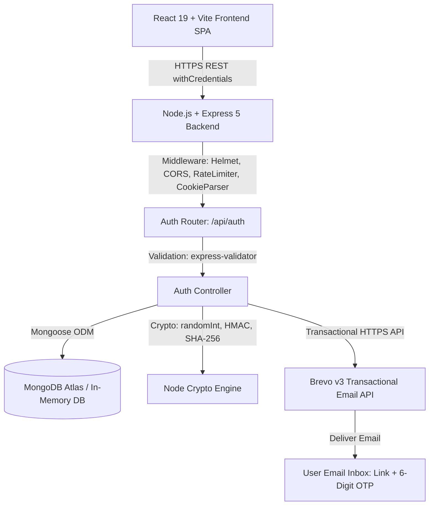

# System Architecture & Technical Specifications

## 1. High-Level Architecture Diagram

---

## 2. Component Breakdown

### Frontend (SPA)
- **Framework:** React 19 + Vite, React Router v7.
- **Styling:** Bootstrap 5, custom design system in `src/index.css` (tokens: `--rm-blue`, `--rm-navy`, `--rm-blue-pale`, contour SVG pattern).
- **HTTP Client:** Axios with `withCredentials: true`, interceptors for 401 handling, and cross-domain token fallback.
- **State Management:** `AuthContext` (manages `user`, `room`, `loading`, session states).
- **Key Auth Views:**
  - `/login`: Form with unverified account redirect and Google Sign-in.
  - `/register`: Full registration with password strength indicators.
  - `/verify-email`: Dual verification interface supporting automatic query token parsing, 6-digit OTP entry, and 60-second resend cooldown timer.
  - `/forgot-password`: Anti-enumeration reset request interface.
  - `/reset-password`: Deep-link reset form with token validation and strength checks.

### Backend (REST API)
- **Runtime:** Node.js (CommonJS modules), Express 5.
- **Security Middleware:** `helmet()`, `cors({ credentials: true })`, `express-rate-limit`, `cookie-parser`, `trust proxy: 1`.
- **Database:** MongoDB via Mongoose 9. Automatically detects if running in test/local development to spin up `mongodb-memory-server` when no remote URI is supplied.
- **Email Delivery:** `services/emailService.js` calling Brevo API (`POST https://api.brevo.com/v3/smtp/email`) with timeout protection (`AbortSignal.timeout(10000)`), resilient error handling, and test-environment mocking.

---

## 3. Cryptographic Token Lifecycle
1. **Email Verification Link Token:**
   - Raw value: 32 bytes cryptographically secure pseudo-random hex string (`crypto.randomBytes(32)`).
   - Database storage: `SHA-256` digest string.
   - Expiration: `Date.now() + 10 * 60 * 1000` (10 minutes).
2. **Email Verification OTP:**
   - Raw value: 6-digit integer string between `100000` and `999999` generated with `crypto.randomInt`.
   - Database storage: `HMAC-SHA-256` digest with server-side `OTP_SECRET` / `JWT_SECRET`.
   - Expiration: `Date.now() + 10 * 60 * 1000` (10 minutes).
   - Comparison: Constant-time buffer comparison (`crypto.timingSafeEqual`).
3. **Password Reset Token:**
   - Raw value: 32 bytes hex string.
   - Database storage: `SHA-256` digest string.
   - Expiration: `Date.now() + 15 * 60 * 1000` (15 minutes).
4. **Session Revocation (`tokenVersion`):**
   - User document contains integer `tokenVersion`.
   - Encoded inside JWT payload: `{ id, tokenVersion }`.
   - Checked during `protect` middleware validation.
   - Incremented upon password reset to revoke all active sessions.
